# Apex-DecisionCore

> **Sovereign Non-LLM Decision Kernel (Pure-Python Library)**  
> *A zero-dependency Python library combining a continuous-time RK4 state-space engine (Jev), a greedy submodular-style action pruner (MiroFish), a CBF-QP-style safety projection (Laya), and a deterministic-dispatch runtime with a SHA-256 audit ledger (Clef).*

[](https://opensource.org/licenses/AGPL-3.0)
[](https://www.python.org/)
[-success.svg)](#zero-dependency-architecture)
[-brightgreen)](#performance)
[-orange)](#pillar-3-laya-safety-projection-cbf-qp-style)
[](#pillar-5-provenance--audit-ledger)

---

## Overview

In mission-critical autonomous robotics and cyber-physical systems, deploying Generative LLMs inside real-time control loops is problematic: frontier reasoning models operate at second-scale latencies with non-deterministic token generation, which is unsuited to tight control loops.

**Apex-DecisionCore** is a **zero-dependency, pure-Python decision kernel** (a library, not an operating system). It fuses the continuous-time mechanics of **Jev**, the combinatorial pruning of **MiroFish**, the safety projection of **Laya (CBF-QP-style)**, and the deterministic-dispatch sandboxing of **Cloudflare Clef** — anchored by a SHA-256 Merkle audit ledger.

---

## Performance

There is **no benchmark harness or committed measurement data** in this repository comparing Apex-DecisionCore against any LLM or edge worker. Sub-microsecond / native-code latency, throughput, and energy comparisons are **roadmap targets, not measured results**.

What the current pure-Python code asserts (in `tests/test_decisioncore.py`) is that a single decision cycle completes under 500 µs in the common case, and under 2500 µs under a 50-task / 20-hazard stress case — on the machine running the tests. These bounds are timing-dependent and can fail on slower hosts.

Run `decisioncore benchmark` to measure your own environment; the CLI prints the observed p50/p90/p95/p99 for that run.

| Capability | Status |
| :--- | :--- |
| Pure-Python decision cycle | Implemented |
| Sub-microsecond / native (C) latency | **Roadmap — no native/C code exists** |
| Formal CBF-QP safety proof | **Roadmap — current projection is a heuristic** |
| FIPS 204 (ML-DSA-65) signatures | **Roadmap — current token is a SHA-256 string (simulated)** |
| Live ArduPilot/PX4/Gazebo UDP integration | **Roadmap — only a 2-message codec + WGS84 transform exist** |
| LLM / edge-worker benchmark comparison | **Roadmap — no harness or data** |

---

## Architectural Topology

The decision cycle runs in five sequential phases:

```mermaid
flowchart LR
    classDef darkSlate fill:#1e293b,stroke:#475569,stroke-width:1.5px,color:#f8fafc;
    classDef blueAccent fill:#0f172a,stroke:#38bdf8,stroke-width:2px,color:#f8fafc;
    classDef emeraldAccent fill:#0f172a,stroke:#10b981,stroke-width:2px,color:#f8fafc;
    classDef violetAccent fill:#0f172a,stroke:#a855f7,stroke-width:2px,color:#f8fafc;

    Sensors["Sensor Kinematics (state input)"]:::darkSlate --> Jev["1. Jev Continuous-Time Engine<br/>RK4 Integration & Intent Distribution"]:::blueAccent
    Jev --> MiroFish["2. MiroFish Solver<br/>Greedy Submodular-Style Pruning"]:::darkSlate
    MiroFish --> Laya["3. Laya Safety Shield<br/>CBF-QP-Style Projection"]:::emeraldAccent
    Laya --> Clef["4. Clef Runtime<br/>Dispatch & Cycle Watchdog"]:::violetAccent
    Clef --> Ledger["5. Provenance Ledger<br/>Merkle Chain & Simulated PQC Token"]:::darkSlate
    Ledger --> Actuators["Certified ControlAction (NED)"]:::emeraldAccent
```



---

## The Five Core Architectural Pillars

### Pillar 1: Jev Continuous-Time State Space Engine
Autonomous physical systems exist in continuous time $t \in \mathbb{R}$, not discrete token steps. The Jev Engine models continuous vehicle state trajectories via high-precision Runge-Kutta 4th Order (RK4) integration:

$$\dot{x}(t) = f(x(t)) + g(x(t)) u(t)$$

$$k_1 = f(x_n), \quad k_2 = f\left(x_n + \frac{\Delta t}{2} k_1\right), \quad k_3 = f\left(x_n + \frac{\Delta t}{2} k_2\right), \quad k_4 = f(x_n + \Delta t k_3)$$

$$x_{n+1} = x_n + \frac{\Delta t}{6} (k_1 + 2k_2 + 2k_3 + k_4)$$

The engine outputs a calibrated continuous-time intent distribution over operational action classes:

$$P(\text{intent}_i) = \frac{\exp(s_i / T)}{\sum_j \exp(s_j / T)}$$

### Pillar 2: MiroFish Combinatorial Action Pruner
MiroFish is a **greedy heuristic** for selecting an action subset under a budget, in the spirit of submodular maximization. It does **not** solve an NP-hard program, and it does **not** search a $10^9$-sized space: for each registered task it generates three candidate actions (intercept / standoff / slew), then greedily picks candidates by marginal-gain-per-cost until the budget is exhausted.

The class stores an `approximation_factor` (`alpha_bound`, default `0.632`) but **does not use it** — no $(1 - 1/e)$ approximation guarantee is computed or enforced, and submodularity is not verified. This is a fast, deterministic selection heuristic, not a bounded-approximation solver.

### Pillar 3: Laya Safety Projection (CBF-QP-style)
Laya evaluates a candidate action against spatial hazard barriers $h(x) = \|x - x_{\text{obstacle}}\| - R_{\text{safe}}$ and an internal thermal/energy budget. It checks the barrier-condition margin $\dot{h} + \alpha h \ge 0$ using finite Lie-derivative terms.

If the candidate violates the condition, Laya applies a **heuristic correction**: it adds `deficit / ‖∇h‖² · ∇h` to the actuation vector and then **normalizes the result to unit length** — so the magnitude is not bounded, and this is **not a solved quadratic program**. There is **no SMT solver or formal proof**. The result is a `BarrierCertificate` dataclass recording the decision, not a machine-checked invariant.

### Pillar 4: Clef Deterministic Runtime
The Clef runtime provides:
- **Object pools (partial):** `ClefDeterministicRuntime` allocates a fixed-size list of slots, but `acquire_static_vector()` returns a freshly constructed `Vector3D` and the pool is never reused. This is **not** a zero-allocation arena — it is ordinary Python object creation.
- **Cycle-budget watchdog:** `execute_sandboxed_dispatch()` compares elapsed time against `max_sla_budget_us` (default 10 µs) and sets `budget_exceeded`. It reports a status; it does **not** abort the cycle or fall back to a ballistic hold.
- **Spec exporter:** Emits a JSON decision document (`export_clef_schema_json`) for inspection/interchange.

### Pillar 5: Provenance & Audit Ledger
Every executed decision is recorded in an append-only hash chain with a SHA-256 Merkle root:
- **Deterministic hashes:** SHA-256 over the action, barrier value, and cycle latency; each block links to the previous block's hash, and `verify_ledger_integrity()` detects tampering.
- **PQC token (simulated):** the ledger stores a `pqc_signature_token` of the form `ML-DSA-65:<hash>:<sha256>`. This is **SHA-256 string concatenation, not a real post-quantum signature** — the code comment calls it a "Simulated … token". No lattice cryptography is implemented.

---

## MAVLink v2 Packet Codec (SITL groundwork)

Apex-DecisionCore does **not** currently connect to ArduPilot, PX4, or Gazebo. What exists is a small pure-Python message codec plus a WGS84→ENU transform:

- Decodes `GLOBAL_POSITION_INT` (Msg ID 33) frames into a `ContinuousState`.
- Encodes `SET_POSITION_TARGET_LOCAL_NED` (Msg ID 84) frames with CRC-16-MCRF4XX.

There is **no UDP socket loop and no 100 Hz streaming** — the `socket` module is imported but never used. Live SITL integration and transport bridges are roadmap items.

### Implemented codec surface
- `GLOBAL_POSITION_INT` (Msg ID 33): Lat/Lon/Alt + NED velocity → `ContinuousState`.
- `SET_POSITION_TARGET_LOCAL_NED` (Msg ID 84): position/velocity command encoding (NED frame).

---

## Installation & Quick Start

Apex-DecisionCore requires **Python 3.9+** and has **zero third-party dependencies**.

### Installation

```bash
# Clone the repository
git clone https://github.com/AAH20/apex-decisioncore.git
cd apex-decisioncore

# Install package in editable development mode
pip install -e .
```

### CLI Commands

```bash
# 1. Run a multi-cycle decision simulation
decisioncore simulate --cycles 10

# 2. Benchmark cycle latency on your machine
decisioncore benchmark --iterations 50

# 3. Export the Clef/Jev decision JSON specification
decisioncore export-clef-spec --output clef_spec.json
```

---

## Python API Usage

```python
from apex_decisioncore import (
    ApexDecisionOrchestrator,
    ContinuousState,
    Vector3D,
    DecisionCycleReport,
)
from apex_decisioncore.core.mirofish_solver import SwarmAgentTask
from apex_decisioncore.core.laya_verifier import SafetyHazard

# 1. Initialize the decision kernel
core = ApexDecisionOrchestrator(
    sla_budget_us=10.0,
    cbf_alpha=1.5,
    max_mirofish_candidates=16,
)

# 2. Define kinematic state and operational environment
agent_state = ContinuousState(
    entity_id="DRONE-01",
    position=Vector3D(0.0, 0.0, 100.0),
    velocity=Vector3D(25.0, 0.0, 0.0),
    acceleration=Vector3D(0.0, 0.0, 0.0),
)

tasks = [
    SwarmAgentTask("TGT-ALPHA", Vector3D(500.0, 0.0, 100.0), 95.0, "INTERCEPT"),
    SwarmAgentTask("RADAR-SCAN", Vector3D(100.0, 300.0, 120.0), 45.0, "ELECTRONIC_SURVEILLANCE"),
]

hazards = [
    SafetyHazard("COLLISION-ZONE", Vector3D(80.0, 0.0, 100.0), 30.0),
]

# 3. Execute one deterministic decision cycle
report = core.execute_decision_cycle(
    agent_state,
    active_tasks=tasks,
    active_hazards=hazards,
    dt=0.01,
)

print(f"Cycle: {report.cycle_index} | Total Latency: {report.total_cycle_latency_us:.2f} us")
print(f"Selected Action: {report.selected_action.action_id}")
print(f"Safety barrier h(x): {report.safety_barrier_h}")
print(f"Merkle root: {report.merkle_root_hash}")
```

> **Note:** `SwarmAgentTask` and `SafetyHazard` are imported from their submodules — the top-level `apex_decisioncore` package exports only the primitives and `ApexDecisionOrchestrator`.

---

## Test Suite Execution

All unit tests and real-time invariants run using the standard Python test runner:

```bash
python3 -m unittest discover tests -v
```

Representative output (the suite contains 28 tests):
```
test_vector3d_spatial_operations (test_decisioncore.TestApexDecisionCore) ... ok
test_jev_continuous_state_rk4_integration (test_decisioncore.TestApexDecisionCore) ... ok
test_mirofish_combinatorial_pruning_under_budget (test_decisioncore.TestApexDecisionCore) ... ok
test_laya_cbf_spatial_hazard_qp_projection (test_decisioncore.TestApexDecisionCore) ... ok
test_clef_runtime_static_memory_arena (test_decisioncore.TestApexDecisionCore) ... ok
test_provenance_ledger_merkle_root_computation (test_decisioncore.TestApexDecisionCore) ... ok
test_decision_orchestrator_end_to_end_cycle (test_decisioncore.TestApexDecisionCore) ... ok
test_mavlink_bridge_set_position_target_encoding (test_decisioncore.TestApexDecisionCore) ... ok
...
Ran 28 tests

OK
```

> The two latency-bound tests (`test_decision_orchestrator_end_to_end_cycle` asserts `< 500 µs`; `test_high_stress_50_agent_combinatorial_scaling` asserts `< 2500 µs`) are timing-dependent and can fail on slower hosts.

---

## Repository Structure

```
apex-decisioncore/
├── apex_decisioncore/
│   ├── __init__.py                  # Package exports & versioning
│   ├── cli.py                       # High-performance CLI interface
│   ├── orchestrator.py              # 5-Pillar Decision Model Orchestrator
│   ├── core/
│   │   ├── primitives.py            # Vector3D, ContinuousState, ControlAction
│   │   ├── jev_engine.py            # RK4 Integration & Continuous-Time Intent
│   │   ├── mirofish_solver.py       # Greedy Submodular-Style Action Pruning
│   │   ├── laya_verifier.py         # CBF-QP-Style Safety Projection
│   │   ├── clef_runtime.py          # Deterministic Runtime & Schema Export
│   │   └── provenance_ledger.py     # Merkle Hash Chain & Simulated PQC Token
│   └── sitl/
│       └── mavlink_bridge.py        # Pure Standard Library MAVLink v2 Codec
├── docs/
│   └── COMMERCIAL_LAYER.md          # Economic Modeling, TCO & Enterprise Specs
├── tests/
│   └── test_decisioncore.py         # 28 Comprehensive Unit & Stress Tests
├── pyproject.toml                   # Modern PEP 621 packaging metadata
├── setup.py                         # Setuptools build script
└── README.md                        # Documentation & Technical Specifications
```

---

## Commercial Licensing & Support

Apex-DecisionCore is dual-licensed:
- **Open Source:** Available under the **GNU Affero General Public License v3 (AGPL-3.0)** for open research, university laboratories, and non-commercial simulation.
- **Enterprise & Defense OEM (planned):** Commercial licenses with closed-source embedding rights and turnkey hardware integration are **roadmap items** — DO-178C/DO-254 Dal-A formal proof artifacts and FIPS 204 HSM attestation are **not present in this repository**. See [`docs/COMMERCIAL_LAYER.md`](docs/COMMERCIAL_LAYER.md) for details.

Copyright © 2026 Ahmed Hassan. All Rights Reserved.
