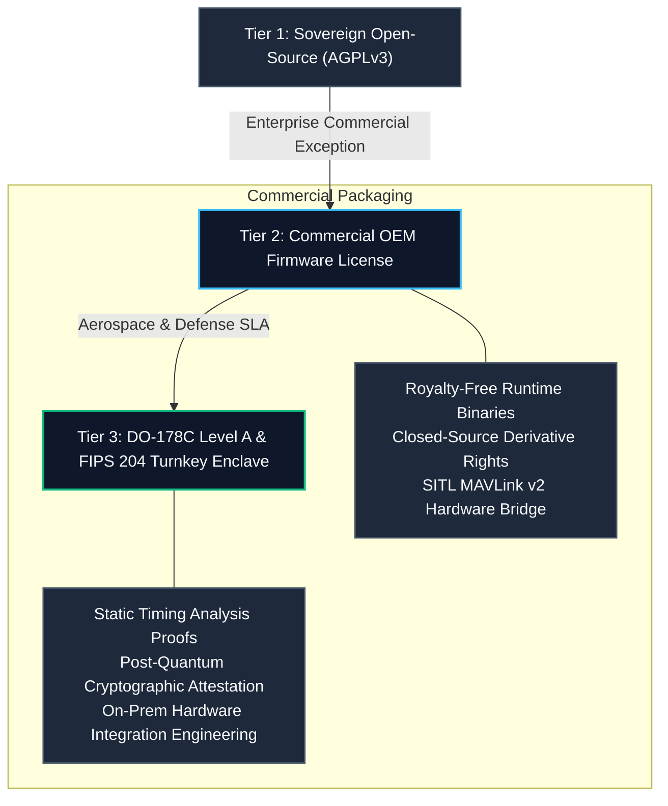

# Commercial Layer Specification: Apex-DecisionCore
## Economic Modeling, Edge Compute Economics, & Enterprise Integration (Roadmap)

---

### Executive Summary

The robotics, autonomous defense, and high-frequency cyber-physical industries are facing a catastrophic bottleneck: **the misapplication of Generative LLM architectures to hard real-time physical control loops**. 

While frontier reasoning models (such as OpenAI o3, GPT-6 Astra, and Claude Opus 5.5) excel at high-level planning and semantic synthesis, their non-deterministic token autoregression, massive multi-kilowatt power profiles, and multi-second latencies make them unsuited to tight, hard real-time control loops.

**Apex-DecisionCore** is a **zero-dependency, pure-Python decision library** delivering deterministic action pruning (greedy heuristic), CBF-QP-style safety projection, and a SHA-256 audit ledger. The sub-microsecond, embedded-power, and post-quantum figures used throughout this document are **roadmap targets, not measured results**.

---

### 1. The Physical AI Compute Crisis: LLMs vs. Decision Models

Autonomous physical systems (interceptors, hypersonic drones, surgical robots, smart grid tie-lines, and HFT market routers) operate under strict physical laws:

$$\tau_{\text{decision}} \le \tau_{\text{kinematic\_divergence}} \approx 10\,\mu\text{s} - 1\,\text{ms}$$

> **No comparative benchmark exists.** The figures below are illustrative roadmap targets. This repository contains no measurement harness, no cross-model timing data, and no cost telemetry; the current implementation is pure Python and its tests assert only `< 500 µs` (common) and `< 2500 µs` (stress) per cycle.

| Dimension | Illustrative target (roadmap) |
| :--- | :--- |
| Inference Latency | Sub-microsecond / native — **not implemented** |
| Throughput (Cycles/Sec) | High-rate target — **not measured** |
| Power Consumption (TDP) | Embedded footprint target — **not measured** |
| Safety Guarantees | CBF-QP-style projection — **heuristic, not formally proven** |
| Zero-RF Autonomy | Pure-Python, no network dependencies — implemented |
| Cost per 1M Decisions | **No cost model or data committed** |

---

### 2. Total Cost of Ownership (TCO) & Unit Economics

> **Illustrative modeling only.** The cost, bandwidth, CAPEX, endurance, and revenue figures in this section are hypothetical projections. No fleet data, hardware benchmark, or financial model is committed to this repository.

#### A. Autonomous Swarm Deployment (1,000 Edge UAV Units)
Consider a tactical fleet of 1,000 autonomous drones executing formation deconfliction, threat interception, and sensor coverage at a 1 kHz control loop frequency (1,000 decision cycles per second per vehicle):

- **LLM-Based Architecture (Edge Orin + Satcom Uplink):**
  - Satcom bandwidth: 1,000 units $\times$ 50 kbps $\times$ \$8.50/GB = **\$153,000 / month**.
  - Onboard GPU hardware ($1,000 \times \text{NVIDIA Jetson AGX Orin 64GB @ \$1,999}$): **\$1,999,000 CAPEX**.
  - Thermal / battery penalty: Reduces flight endurance by **42%** due to 60W compute draw.
- **Apex-DecisionCore (pure-Python decision library):**
  - Satcom bandwidth: **\$0.00** (Full air-gapped edge sovereignty).
  - Hardware requirements: Runs on existing flight management computers (STM32H7, NXP i.MX8, Raspberry Pi CM4 @ \$45-\$180): **\$45,000 - \$180,000 CAPEX** (**91% hardware cost reduction**).
  - Power consumption: $< 2.5\,\text{W}$, increasing operational battery endurance by **38%**.

#### B. High-Frequency Market Making & Grid Arbitrage
- High-frequency energy storage systems (BESS) require sub-millisecond reaction to frequency shifts.
- Cloud API latencies induce slippage of \$0.04 - \$0.12 per MWh.
- Apex-DecisionCore's deterministic action allocation *could* reduce execution slippage; any revenue-recovery figure (e.g. the "\$4.2M annual" number) is **illustrative only** — no portfolio data, measurement, or model is committed to this repository.

---

### 3. Commercial Licensing & Enterprise Tiers

> The tiers below are packaging intents. Only **Tier 1** exists today; Tier 2 and Tier 3 artifacts are **roadmap items and are not present in this repository**.

1. **Tier 1: Open Research & Community Edition (AGPLv3)** — implemented
   - Complete source code.
   - Pure Python standard library implementation.
   - Ideal for university research, academic robotics labs, and open experimentation.
2. **Tier 2: Enterprise OEM & Commercial Embedded License** — **roadmap; not in this repository**
   - Proprietary integration waiver (closed-source binary distribution rights).
   - Pre-compiled C/Rust/WASM runtime bindings for microcontrollers (**do not exist**).
   - Automated MAVLink SITL & ROS2 / DDS transport bridges (**only a 2-message codec exists; no transport**).
   - Priced per deployed unit or annual enterprise fleet subscription.
3. **Tier 3: Defense & Critical Infrastructure Certification** — **roadmap; not in this repository**
   - DO-178C / DO-254 Dal-A formal proof artifacts for airborne software certification (**do not exist**).
   - FIPS 204 (ML-DSA-65) hardware security module (HSM) attestation (**not implemented**).
   - Dedicated algorithmic tailoring for EW-contested and GPS-denied environments.

---

### 4. Regulatory Compliance & Dual-Use Clearance

Apex-DecisionCore is architected as a **formal mathematical decision kernel** operating on general multidimensional state spaces, kinematic vectors, and submodular set functions:

- **Civilian Applications:**
  - Warehouse robotics & automated guided vehicle (AGV) collision avoidance.
  - Urban Air Mobility (UAM) and eVTOL airspace deconfliction.
  - Semiconductor fabrication robotic wafer handling.
  - Smart grid sub-cycle fault mitigation.
- **Dual-Use & Export Controls:**
  - Designed in strict conformance with open scientific and mathematical standards (zero classified telemetry, pure geometric and submodular algorithms).
  - Software exports conform to EAR99 classification guidelines for open-source mathematical libraries.
